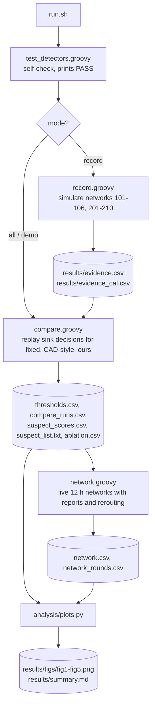
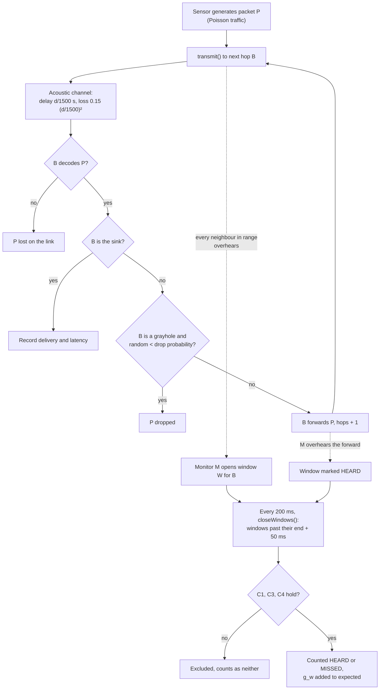
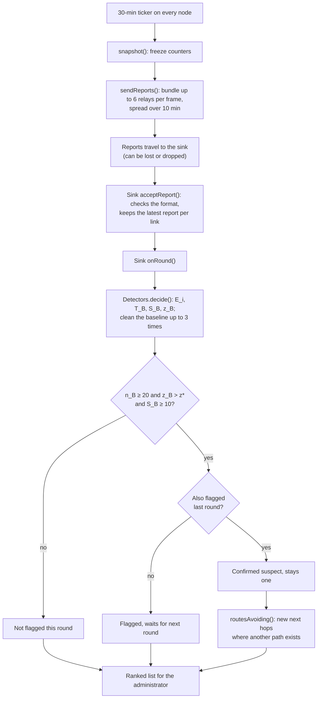

# Project flow

How the project runs from start to end: which file starts each step, what each file reads and writes, and which messages move between nodes in the simulation.

## 1. Entry point

Everything starts at `run.sh`, run from the repository root.

| Command | What runs | Time |
|---|---|---|
| `./run.sh demo` | self-check, compare, one live network (topology 201, 3 grayholes) | about 3 min |
| `./run.sh` | self-check, compare, all live networks, graphs (uses the recorded evidence) | about 1 h |
| `./run.sh record` | the same, but records the evidence again first | several hours |

`run.sh` starts each Groovy script with `tools/unet-7.0.0/bin/unet` from inside `unet/`. UnetStack can exit with code 0 after an error, so `run.sh` checks the log for the script's end marker (`PASS`, `RECORD_COMPLETE`, `COMPARE_COMPLETE`, `NETWORK_COMPLETE`). If the marker is missing, the run stops and prints the log path. Logs go to `results/logs/`.

## 2. Pipeline flowchart

In demo mode, the pipeline stops after one `network.groovy` run and prints the ranked suspect list. It does not run `plots.py`.

## 3. Files and their purpose

### Simulation code (`unet/`)

| File | Purpose | Reads | Writes |
|---|---|---|---|
| `MonitorNode.groovy` | The agent on every node. It generates data, relays packets, drops packets if it is a grayhole, watches every relay it overhears, and sends reports. On the sink, it also receives reports and runs the decision. | PHY notifications from UnetStack | counters in memory, report frames |
| `Detectors.groovy` | The three detection methods (`fixed`, `cad`, `ours`), baseline cleaning (`peel`), the dynamic threshold, and two-round confirmation (`confirm`). All methods read the same counters. | evidence rows | flagged set, ranking, scores |
| `Topology.groovy` | Random node positions, redrawn until every sensor reaches the sink. Shortest-hop routes, and routes that avoid suspects. | seed | positions, next hops |
| `DistanceLossChannel.groovy` | The acoustic channel. A frame decodes with probability `1 − 0.15 (d/1500)²`. | distance | decode probability |
| `test_detectors.groovy` | Self-check against hand-computed values. | none | prints `PASS` |
| `record.groovy` | Step 1. Simulates every scenario and stores every monitor's 32 counters every 30 min. | none | `results/evidence*.csv` |
| `compare.groovy` | Step 2. Replays the sink's 30-min decision loop for each method on the same recorded counters. Chooses thresholds on tuning networks 101–106 only. | `evidence*.csv` | `thresholds.csv`, `compare_runs.csv`, `suspect_scores.csv`, `suspect_list.txt`, `ablation.csv` |
| `network.groovy` | Step 3. Live 12-hour networks. Reports travel over the acoustic channel, the sink decides, and routes change. | `thresholds.csv` | `network*.csv`, `network_rounds*.csv` |
| `forward_delay.groovy` | Measures how long honest relays hold a packet. This sets the 2 s window allowance. It is not part of `run.sh`. | none | `results/forward_delay.txt` |

### Analysis and results

| File | Purpose |
|---|---|
| `analysis/plots.py` | Step 4. Reads the result CSVs and draws `results/figs/fig1–fig5.png` and `results/summary.md`. |
| `results/summary.md` | All numbers quoted in the reports. |
| `results/isolate_runs/` | Older runs in which suspects were cut off instead of avoided. |

### Documents and reports

| File | Purpose |
|---|---|
| `INFO.md` | Team, deadlines, course rules. |
| `docs/METHOD.md` | Method, assumptions and derivation. |
| `docs/HANDOFF.md`, `docs/STUDY_GUIDE.md` | Current state and viva preparation. |
| `report/progress/main.tex`, `figs/` | Progress report and its Mermaid figures. |
| `report/final/main.tex` | Draft of the final report. |
| `Documents/` | Reference paper and the submitted proposal. |

### Tools

| Path | Purpose |
|---|---|
| `tools/unet-7.0.0/` | UnetStack 7 community edition. |
| `tools/jdk8/` | Java 8, used by UnetStack through `runtimes/java`. |

## 4. Messages inside the simulation

UnetStack has no request and response in the web sense. Nodes exchange frames, and each agent reacts to notifications from the physical layer. `MonitorNode.processMessage()` handles them:

| Notification | When it arrives | What the agent does |
|---|---|---|
| `TxFrameStartNtf` | own frame starts | records the transmit interval (used for C1) and busy time |
| `RxFrameStartNtf` | a frame starts arriving | adds busy time |
| `TxFrameNtf` | own frame has left | opens a watch window for its next hop |
| `RxFrameNtf` (DATA) | a frame decoded | records the sender's interval (C3, C4). If an open window waits for this packet from this node, marks it HEARD. If the frame is for this node, calls `onPacket()`. Otherwise opens a window for the frame's destination. |
| `BadFrameNtf` | corrupted frame | stores the interval. This is condition C2, which our detector does not use. |

The nodes send two kinds of frames:

| Frame | Size | Path |
|---|---|---|
| Data packet | 8 bytes: origin, sequence, generation time, hops | sensor → relays → sink |
| Report | 12-byte header + 17 bytes per relay, at most 6 relays per frame | every node → relays → sink, every 30 min |

Reports travel like data, so a report can be lost, and a grayhole can drop it.

## 5. What happens to one packet

## 6. What happens every 30 minutes

Route changes happen at once and cost nothing in this model. No route messages are sent.

## 7. Exit points

| What ends | Exit |
|---|---|
| A script | prints its end marker. `run.sh` checks for it, and a missing marker stops the run with `FAILED <script>`. |
| A live run | 12 h of simulated time. Packets still in flight count as not delivered. |
| The full pipeline | prints `PIPELINE COMPLETE — results/summary.md, results/figs/`. |
| The demo | prints the ranked suspect list from `results/logs/network_demo.log`. |
