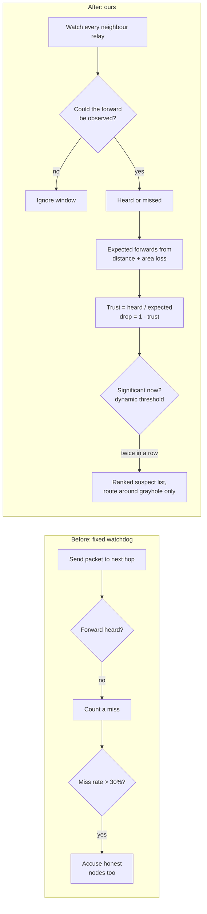

<h1 align="center">Observability-Aware Trust-Based Grayhole Detection for Underwater Acoustic Networks</h1>

<p align="center">A network-layer watchdog that judges forwarding only when the monitor could observe it, compares it with the loss an honest relay would show, and reports a ranked list of suspects.</p>

<p align="center">
  
  
  
  
</p>

<p align="center">
  
  
  
</p>

## The problem (before)

Relays in an underwater acoustic network forward packets to the sink. A **grayhole** relay secretly drops some of them. The classic defence is a **watchdog** (e.g. Chandavarkar and Suresh, UnetStack3): a node sends a packet to its next hop, listens for the forward, and accuses the next hop when too many forwards are missing.

Underwater, silence is ambiguous. A forward can be missing because the relay dropped it, because the packet collided before reaching it, because the monitor was transmitting itself (half-duplex), or because the long acoustic link lost it. As traffic grows, these innocent losses grow too. A fixed threshold then forces a bad choice: catch every grayhole by also **accusing many honest relays**, or accuse fewer and **miss grayholes**. Cutting out honest relays breaks routes, so delivery and throughput fall.

## Our method (after)

1. **Judge only what could be observed (observability filter).** A watch window counts only if the monitor could have heard the forward: it was not transmitting itself, the relay was not transmitting when the packet arrived, and no known frame collided at the relay.
2. **Expect the right amount of loss for each link (link awareness, Mohit sir's area idea).** From link distances, compute how many forwards an honest relay should show; add the normal loss of the link's distance area (near / medium / far), learned from the *other* relays. Trust is the area-weighted average of the monitors' trust values: `T = sum(heard) / sum(expected)`, and the estimated drop rate is `1 − T`.
3. **Dynamic threshold.** Flag a relay only when its shortfall is statistically significant for the current network (threshold adapts to the number of judged relays and the measured spread). Confirmed grayholes stop counting as "normal", so the next grayhole stands out (multiple grayholes).
4. **Confirm, then act.** A relay becomes a suspect only after two flagged 30-min rounds in a row; the sink then gives the administrator a **ranked suspect list** and routes traffic around the suspects wherever another path exists.

## Before and after, step by step

The baseline watchdog (as in Chandavarkar and Suresh's UnetStack3 demonstration) follows two rules:

- *Rule 1: after sending a packet to the next hop, listen for its forward; a forward not heard in time is a miss.*
- *Rule 2: if the misses exceed a fixed threshold, accuse the next hop.*

Taking into account what an underwater acoustic node can actually observe, we made three modifications:

- **Observability:** a miss counts only if the monitor could have heard the forward; windows hidden by its own transmission or by a collision at the relay are ignored, not counted against the relay.
- **Trust from the expected loss of each link:** every link has its own expected number of forwards (distance plus the normal loss of its near/medium/far area), so a long or busy link is not mistaken for a dropping one; trust = heard ÷ expected, combined over all monitors.
- **Evaluation with a dynamic threshold and confirmation:** a relay is flagged only when its shortfall is significant for the current network, and becomes a suspect only after two flagged rounds in a row; confirmed grayholes leave the baseline so further grayholes stand out.



## One pipeline

```bash
./run.sh demo     # lab demo, ~3 min: one network with 3 grayholes, all methods, ranked suspect list
./run.sh          # full results from the recorded evidence (~1 h), five graphs + results/summary.md
./run.sh record   # also re-record the evidence first (several hours)
```

| Step | File | What it does |
|---|---|---|
| 1. record | `unet/record.groovy` | Simulates the networks in UnetStack and stores every monitor's counters |
| 2. compare | `unet/compare.groovy` | Replays the sink's decisions for every method on the same counters; ranked suspect list |
| 3. live network | `unet/network.groovy` | Reports travel over the acoustic channel, the sink detects, confirms and routes around suspects; delivery measured |
| 4. graphs | `analysis/plots.py` | Five graphs and `results/summary.md` |

Core code: `unet/MonitorNode.groovy` (node: traffic, grayhole, watch windows, reports), `unet/Detectors.groovy` (fixed watchdog, CAD-style, ours), `unet/Topology.groovy` (deployment and routing). Self-check: `unet/test_detectors.groovy`.

Requirements: UnetStack 7.0.0 in `tools/unet-7.0.0` with Java 8 in its `runtimes/java`, Python 3 and `uv` for the graphs.

## Results

20-node networks in UnetStack, grayholes = the busiest relays dropping 30%; 10 test topologies; thresholds tuned on 6 separate networks never used for testing. All numbers and confidence intervals: [results/summary.md](results/summary.md).


| Live network, 12 h (pooled: 1 grayhole at two loads, 2 and 3 grayholes) | Grayholes caught | Honest nodes accused per run | Delivery ratio | Throughput (pkt/h) |
|---|---|---|---|---|
| No attack (ceiling) | – | – | 57.0% | 228.6 |
| Attack, no defence | 0% | 0 | 45.6% | 186.8 |
| Fixed watchdog (before) | 100% | **7.2** | 47.0% | 190.6 |
| CAD-style (before) | 58% | 0.8 | 48.0% | 193.3 |
| **Ours (after)** | **95%** | **0.3** | **49.7%** | **200.5** |

- **Fewer false accusations (fig2):** the fixed watchdog's honest accusations rise with traffic (1 → 6 per run with no attacker); ours stays at 0–0.1.
- **Grayholes still caught (fig3):** with every method held to the same false-alarm budget, ours detects 90% of single grayholes (CAD-style 58%, fixed 22%), 95% with two grayholes (65%, 40%) and 77% with three (77%, 40%), accusing 0% of honest relays in the 2- and 3-grayhole cases.
- **Neat suspect list (fig4):** the grayholes rank first with 28–39% estimated drop; honest relays sit at 0%. The estimate tracks the true drop rate (10/20/50% → 7/19/47%).
- **Delivery and throughput (fig5):** ours is highest in every setting; versus no defence +1.7 to +5.6 points of delivery, significant in 3 of 4 settings; versus the fixed watchdog +4.0 points with 2 and 3 grayholes. If suspects are blacklisted instead, the fixed watchdog's false accusations cut delivery to 23% (no defence 46%).

Where ours is not clearly ahead: delivery versus CAD-style is higher in every setting but within the uncertainty; with three grayholes ours and CAD-style detect equally often at the same budget; in traffic-hotspot and 40-node networks ours accuses more honest relays than the fixed watchdog at the same budget (about 10% vs 1–3%).


## Honest limits

- Static topologies, known node positions, a known distance–loss curve and truthful monitors; dishonest reports and mobility are not tested.
- The comparators are a fixed watchdog and a CAD-style adaptation, not full reproductions of published systems.
- Route updates are instantaneous and free in the simulation; report traffic is simulated and counted.

## Team

CS301 Computer Networks mini project (2026–27), Team 9, NITK Surathkal.

| Member | Roll number | GitHub |
| --- | --- | --- |
| Appaji Nagaraja Dheeraj | 241CS110 | [AppajiDheeraj](https://github.com/AppajiDheeraj) |
| Aryan Bokolia | 241CS111 | [yoman12357](https://github.com/yoman12357) |
| Karthikeya Gupta | 241CS117 | [karthikeyagupta108](https://github.com/karthikeyagupta108) |

## Acknowledgements

CS301/CS302 course staff and Mohit sir, NITK Surathkal.
