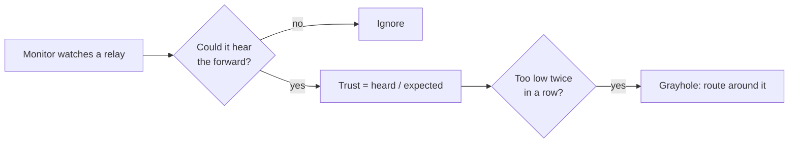
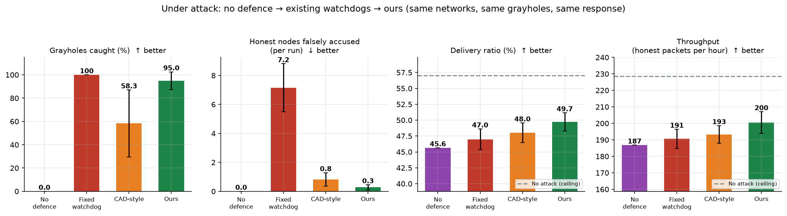

# **Observability-Aware Trust-Based Grayhole Detection for Underwater Acoustic Networks**

CS301 Computer Networks Mini Project · Team 9 · NITK Surathkal · built in **UnetStack 7**

---

## Team Details

<details>
  <summary>Detail</summary>

> **Member-1:** Appaji Nagaraja Dheeraj, 241CS110, [appajidheeraj.241cs110@nitk.edu.in](mailto:appajidheeraj.241cs110@nitk.edu.in)

> **Member-2:** Aryan Bokolia, 241CS111, [aryanbokolia.241cs111@nitk.edu.in](mailto:aryanbokolia.241cs111@nitk.edu.in)

> **Member-3:** Karthikeya Gupta, 241CS117, [karthikeyagupta.241cs117@nitk.edu.in](mailto:karthikeyagupta.241cs117@nitk.edu.in)

</details>

---

## The Idea

A **grayhole** is a relay that secretly drops some of the packets it should forward.

The usual watchdog blames a relay whenever it doesn't hear the forward. But under water, forwards also get lost to collisions and long links, so **honest relays get blamed too**.

We only judge forwards the monitor **could actually hear**, and compare them with how many an **honest relay should** deliver on that link.



---

## Result

| Method | Grayholes caught | Honest relays wrongly accused |
| --- | ---: | ---: |
| Fixed watchdog | 100% | 7.2 per run |
| **Ours** | **95%** | **0.3 per run** |



Full numbers: [results/summary.md](results/summary.md)

---

## Run

```bash
./run.sh demo   # 3-minute demo
./run.sh        # all results and graphs
```

Needs UnetStack 7.0.0 in `tools/unet-7.0.0` (with Java 8) and Python `uv`.

---

This project uses the [MIT License](LICENSE).
